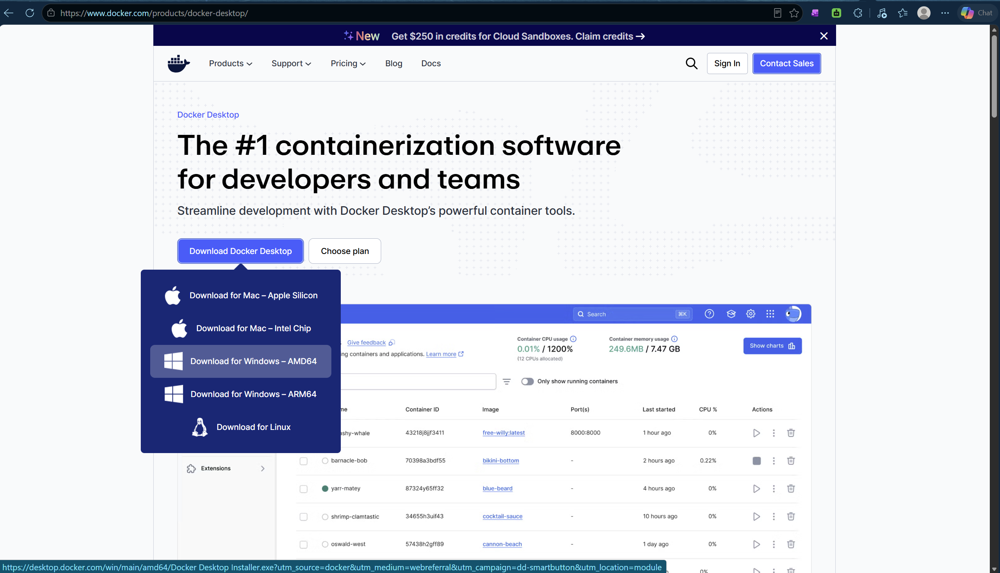
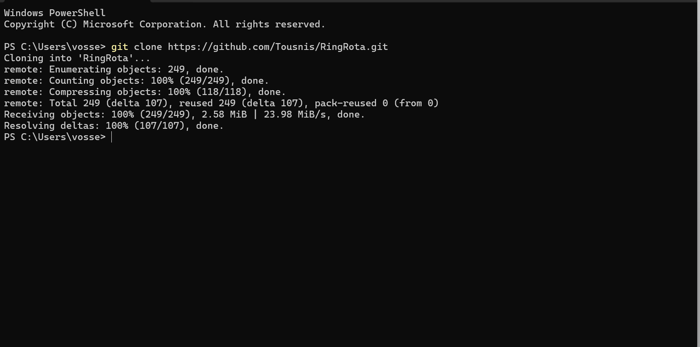
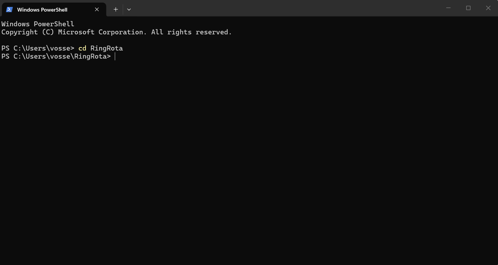
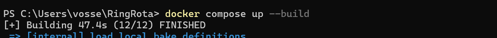
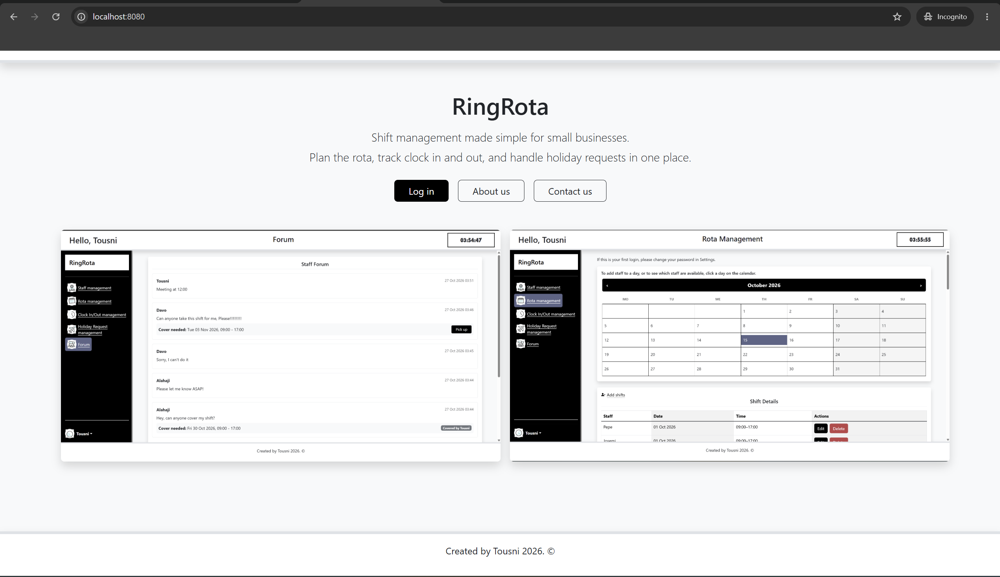
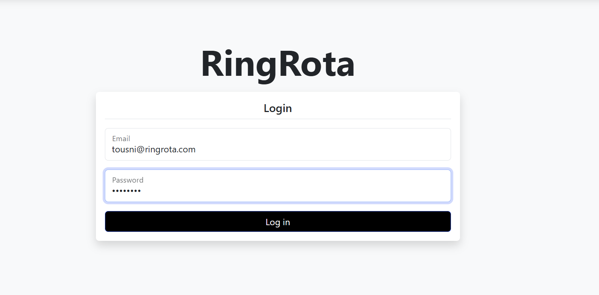

# RingRota

RingRota is a web application for managing staff rotas and shifts in one place.
Admins create shifts and manage staff; staff see their shifts, clock in and out,
request holidays and ask for cover on the forum.

Built as the artefact for my BSc (Hons) Computing dissertation at Arden University (RES6011).

## Technologies

- Java 17
- Spring Boot 4.1.1 (Spring Security, Spring Data JPA)
- Thymeleaf
- MySQL 8
- Bootstrap 5.3.8
- js-year-calendar
- Docker

## Architecture

RingRota uses a layered structure: **Controller → Service → Repository**.

- **Controllers** handle the page requests.
- **Services** hold the logic and turn entities into DTOs.
- **Repositories** talk to the database.

## Database

- **Staff**: name, email, phone, hashed password, role
- **Shift**: date, start and end time (linked to a staff member)
- **Clock**: date, clock-in, clock-out, status (linked to a staff member)
- **Holiday**: from and to date, status (linked to a staff member)
- **Post**: message, time posted, status (linked to a staff member, and to a shift for cover posts)

## Getting started

All you need is [Docker Desktop](https://www.docker.com/products/docker-desktop/).

**1) Get Docker**
Download Docker Desktop and pick the version for your computer (e.g. Windows – AMD64).



**2) Get the code**
```
git clone https://github.com/Tousnis/RingRota.git
```



**3) Go into the project folder**
```
cd RingRota
```



**4) Start RingRota**
```
docker compose up --build
```



**5) Open the app**
Go to **http://localhost:8080** once the log shows `Started RingRotaApplication`.



**6) Log in**
Use a test account below.



To stop it: `Ctrl + C`.

## Test accounts

- **Admin**: Email: Tousni@ringrota.com / Password: admin123
- **Staff**: Email: Alahaji@ringrota.com / Password: admin123

All data is made up and resets every time the app starts.

## Licences

Third-party licences are in the [`licenses`](licenses) folder in the project.

## Author

Tousni Sillah
